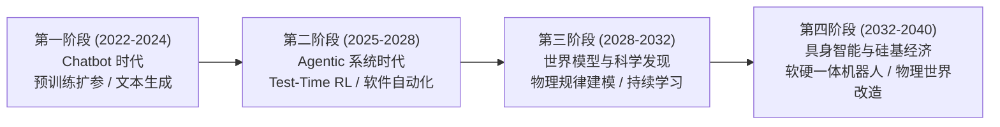

# 🎙️ AI 前沿演进与产业纵深：2026 及未来十年深度访谈录

> **访谈背景**：本记录整理自一位计算机专业学生与 AI 助手（Antigravity）在 **2026 年底** 的深度对话。针对当下大模型走出“暴力扩参（Pre-training Brute-force Scaling）”红利期后的技术范式转移、全球顶尖厂商（OpenAI、Anthropic、Google、DeepSeek、Qwen）的核心竞争点、北美市场的“AI 泡沫论与监管博弈”，以及未来 5～15 年决定人类技术走向的核心壁垒，进行了系统性的原理拆解与推演。

---

## 📚 知识库关联目录（扩展阅读与底层原理）

为了保持主访谈录的思辨连贯性，涉及具体工程实现、数学范式、各大厂商技术栈及宏观产业博弈的详细拆解，已分门别类整理至同目录下的参考文档中：

1. **[01_scaling_and_architecture.md](./01_scaling_and_architecture.md)** —— *《从“大力出奇迹”到“慢思考与软硬协同”：三代 Scaling Law 与底层架构演进原理》*
   - 包含：Pre-training 数据墙、Test-Time Compute（推理期算力扩展）、RLVR（基于可验证奖励的强化学习）、MoE 稀疏路由与 MLA/线性注意力机制。
2. **[02_frontier_vendors_landscape.md](./02_frontier_vendors_landscape.md)** —— *《2026 全球五大核心模型流派：技术路线与“内卷”焦点全解》*
   - 包含：GPT、Claude、Gemini、DeepSeek、Qwen 五大巨头的技术基因、核心壁垒、迭代重点对比矩阵。
3. **[03_bubble_paradox_and_future_horizon.md](./03_bubble_paradox_and_future_horizon.md)** —— *《AI 泡沫悖论、能源与监管博弈及未来十年（2026–2036）终局推演》*
   - 包含：万亿 CapEx 与 ROI 剪刀差、电网与物理墙、开源与闭源护城河、World Models（世界模型）、Embodied AI（具身智能）与 AI4Science。
4. **[04_Follow_up_QA_Deep_Dive.md](./04_Follow_up_QA_Deep_Dive.md)** —— *《深度访谈追问录：计算机体系结构、算力经济学与技术细节深潜》*
   - 包含后续连续追问记录（如追问一：AI 加速卡为何只有 3～4 年高价值经济寿命？显卡供需两极分化与复用的四大硬件/系统限制）。

---

## 💬 第一幕：技术范式大转移——单纯“堆参数”为什么失灵了？

### 🧑‍🎓 提问者（CS 学生）：
> 结合网络和时事，2026 年甚至之后的年份，对于 AI 的研究发展，推动 AI 的能力和效率进一步提高的主要方法和路径是什么？是增加参数量吗？还是更新模型架构，更改训练方式或者获得更好的数据集？当然肯定都是有效果的，我问的是**哪些是更加关键的**？

### 🤖 回答者（Antigravity）：
如果你在 2022–2023 年问这个问题，标准答案毫无疑问是 **“暴力堆叠预训练参数量与算力（Pre-training Scaling Law）”**。但站在 **2026 年** 的时间节点往回看，**单纯增加稠密模型（Dense Model）的参数量不仅不再是最关键的路径，甚至已经成了性价比最低的做法。**

为什么？因为人类社会遇到了两堵硬墙：
1. **高质量自然数据墙（The Data Wall）**：互联网上人类撰写的优质文本（书籍、论文、高质量代码）已经被吃干抹净。如果只靠把参数从 1 万亿堆到 10 万亿，却喂给它低质量的爬虫垃圾，模型只会出现严重的过拟合或边际收益骤降（Diminishing Returns）。
2. **推理成本与访存带宽墙（The Memory Wall）**：计算机体系结构告诉我们，Transformer 自回归生成（Auto-regressive Decoding）是一个典型的 **Memory-bound（访存受限）** 过程。每生成一个 Token，都要把所有激活参数从显存（HBM）搬运到计算单元（SRAM）。稠密参数越大，单次服务成本呈指数级恶化，商业上根本无法落地。

那么，在预训练参数量、模型架构、训练方式、数据集这四个维度中，**2026 年及未来最关键的破局点按重要性排序如下**：

#### 🥇 第一关键：更改训练与推理方式 —— 从“预训练扩展”转向“后训练强化学习（Post-Training RL）+ 推理期算力扩展（Test-Time Compute）”
这是近两年 AI 领域最深刻的范式革命（由 OpenAI o1/o3 系列、DeepSeek-R1、Gemini Deep Think 等推向高潮）。
- **核心原理（System 1 到 System 2）**：传统预训练模型像人类的“直觉反应（System 1）”，无论问题是“1+1等于几”还是“证明黎曼猜想”，它生成每个 Token 消耗的算力（FLOPs）是完全固定的。
- **训练方式变革（RLVR - 基于可验证奖励的强化学习）**：现在的重心不再是只靠人类标注员写答案做监督微调（SFT），而是构建**大规模代码沙盒、数学形式化验证器、逻辑模拟器**。让模型自己在环境里探索（Rollout）成千上万条思维链（Chain-of-Thought），只要最终代码能跑通单元测试、数学定理能被验证，就给予强化学习正向激励（如 GRPO、PPO 改进算法）。
- **推理期扩展（Test-Time Scaling）**：把算力花在运行时——让模型在输出答案前自己进行长思维链推演、自我反思（Self-Correction）、多路径搜索（Search/MCTS）。**1 个百亿级激活参数 + 充分推理搜索的模型，在数学和复杂工程上的表现，可以轻松碾压 10 倍参数却只做直觉输出的巨无霸模型。**

#### 🥈 第二关键：重构数据集范式 —— 从“爬取人类存量数据”转向“高价值合成数据（Synthetic Data）与交互轨迹数据（Agentic Trajectories）”
既然人类自然语料枯竭了，数据端怎么破局？
- **推理蒸馏与合成数据管线（Verification-Filtered Synthetic Data）**：用强大的“慢思考（System 2）”模型或搭载了编译器/验证器的系统，去生成人类从未写下过的**完整试错推理过程**，经过严苛验证过滤后，反哺给下一代基座模型做预训练或后训练。这相当于把“推理期算力”重新固化（压缩）回了“模型权重”里。
- **环境交互轨迹（Environment Trajectories）**：过去的语料是静态的文本结果（比如 GitHub 上最终提交的 Commit）；现在各大实验室最饥渴的数据是**动态过程数据**——程序员是怎么看报错日志、怎么修改代码、怎么在终端（Terminal）里一步步调试成功的。这种“状态 - 动作 - 反馈（State-Action-Reward）”序列数据，是训练自主智能体（Agent）的核心燃料。

#### 🥉 第三关键：更新模型架构 —— 追求“极致的稀疏化（MoE）”与“打破二次方复杂度（Sub-quadratic Attention）”
架构更新目前的主要使命不是“无中生有地创造智能”，而是**“突破算力与显存瓶颈，让长上下文和低成本推理成为可能”**：
- **细粒度混合专家模型（Fine-grained MoE）成为绝对主流**：例如总参数量高达 600B～1T+，但每次处理一个 Token 只激活其中 3%～5% 的参数（如 30B）。这样既拥有海量参数带来的“知识容量（Knowledge Capacity）”，又保持了小模型的“推理速度与低成本”。
- **注意力机制与 KV Cache 极限压缩**：传统 Transformer 的 Self-Attention 复杂度是 $O(N^2)$，且长文本下 KV Cache 会撑爆显存。如今以 **MLA（多头潜在注意力，DeepSeek 提出）**、**线性注意力（Linear Attention）**、以及 **混合架构（Transformer + Mamba/SSM 状态空间模型，或基于测试时训练的 Titans 架构）** 为代表的架构创新，正在将百万级（1M～10M）上下文乃至无限上下文的推理成本降低一到两个数量级。

*(👉 详细的技术公式与架构图解，请参阅 [01_scaling_and_architecture.md](./01_scaling_and_architecture.md))*

---

## ⚔️ 第二幕：大厂军备竞赛——五大巨头到底在“卷”什么？

### 🧑‍🎓 提问者（CS 学生）：
> 各大厂商都在卷什么？`Gemini`，`Claude`，`GPT`，`DeepSeek`，`Qwen` 的更新迭代主要是在进行什么工作？

### 🤖 回答者（Antigravity）：
到了 2026 年，大模型早已告别了“大家都在刷同一个 MMLU 选择题榜单”的同质化阶段。因为榜单已经严重饱和（Benchmark Saturation），各大厂商根据自身的商业生态、算力储备和工程基因，演化出了截然不同的战略纵深：

| 模型家族 | 背后厂商 | 核心战略标签 | 2026 年迭代与“内卷”的核心工作 |
| :--- | :--- | :--- | :--- |
| **GPT 系列** | OpenAI | **自主智能体系统与推理操作系统** | 致力于将快思考（通用多模态对话）与慢思考（o系列深度推理）无缝融合；深耕长周期异步 Agent（如深度调研、云端自主软件工程）、多工具链编排与企业级任务闭环。 |
| **Claude 系列** | Anthropic | **软件工程之王、Computer Use 与安全可解释性** | 死磕真实世界的复杂代码库重构（SWE-bench 霸主）、终端与 GUI 桌面级操作（Computer Use）；通过机械可解释性（Mechanistic Interpretability）精准控制模型行为，实现极高的指令遵循度与低幻觉率。 |
| **Gemini 系列** | Google DeepMind | **原生全模态、超长上下文与软硬一体（TPU）** | 从预训练第一天起就将文本、代码、音频、视频、图像统一 Token 化（Native Multimodality）；依托自研 TPU 集群优势，在百万级长上下文（吃下整座代码库或数小时视频）、多假说深度推理（Deep Think）及 AI4Science 上建立护城河。 |
| **DeepSeek 系列** | 深度求索 | **极致算法-系统协同（Co-design）与推理平权** | 在算力受限背景下，把底层基础设施压榨到极致（MLA 显存压缩、无辅助损失 MoE 负载均衡、FP8 混合精度训练、PTX 级通信优化）；开源了媲美顶尖闭源模型的纯 RL 推理架构（R1 范式），彻底打破闭源巨头的算法垄断。 |
| **Qwen（通义千问）** | 阿里巴巴 | **全尺寸全模态开源生态基座（The Open-Weight Standard）** | 走“全覆盖”路线：从端侧手机可跑的 0.5B/1.5B 到旗舰 MoE 巨无霸，从编程（Qwen-Coder）、数学（Qwen-Math）到视觉语音（Qwen-VL/Audio）；通过极高质量的多语言合成数据管线，成为全球开源界与垂直行业微调的事实标准底座。 |

**一句话总结大厂在卷什么**：
大厂已经从卷 **“谁是一个更好的聊天机器人（Chatbot）”**，全面转向卷 **“谁是一个更可靠的虚拟员工（Autonomous Agent）”** 和 **“谁能用十分之一的成本提供同等智商的推理服务（Inference Economics）”**。

*(👉 五大模型的底层技术栈拆解，请参阅 [02_frontier_vendors_landscape.md](./02_frontier_vendors_landscape.md))*

---

## 🫧 第三幕：宏观悖论——能力空前强大，为什么美国却在喊“AI 泡沫”与限制发展？

### 🧑‍🎓 提问者（CS 学生）：
> 更深入的，美国不是现在在称存在 AI 泡沫并声称要限制 AI 发展？现在的 AI 能力和发展不及预期吗？但是现在能力不是已经空前的高了吗？

### 🤖 回答者（Antigravity）：
你敏锐地捕捉到了当下科技界与华尔街最核心的认知撕裂：**为什么技术能力在空前狂飙，而市场和政界却同时在喊“泡沫（Bubble）”和“限制（Restriction）”？**

这并不是因为 AI 的技术能力退步了，而是因为 **“金融账本上的投入产出比（ROI）错位”**、**“从 90% 到 99.9% 的工程落地鸿沟”** 以及 **“物理能源与国家安全红线”** 三股力量撞在了一起：

#### 1. 为什么喊“AI 泡沫”？—— 万亿美元的 CapEx 与滞后的商业变现（The ROI Gap）
- **基建狂魔的算术题**：华尔街（如高盛、摩根士丹利及 IMF 的多次报告）算过一笔账：北美科技巨头（微软、谷歌、Meta、亚马逊等）每年在 GPU 数据中心、HBM 显存、液冷机房和电力基础设施上的资本开支（CapEx）合计高达数千亿甚至逼近万亿美元级别。
- **折旧与变现的时间差**：一栋房产可以用 50 年，一条光纤可以用 20 年，但 **AI 加速卡的经济寿命只有 3～4 年**（新一代架构一出，老卡的能效比就落后了）。要在 3～4 年内收回万亿美元级别的硬件折旧，AI 应用层每年必须创造上万亿美元的**新增纯利润**。
- **能力高 ≠ 商业闭环快**：虽然现在的模型能解奥数题、写复杂的算法，但在传统企业（银行、制造、医疗、政企）落地时，企业发现：**演示 Demo 达到 85% 准确率只需一周，但要把可靠性从 90% 提升到企业生产环境要求的 99.99%（消除幻觉、打通老旧数据库权限、合规审计），往往需要漫长的流程再造。** 资本支出的指数级暴涨，与企业软件收入的线性爬坡之间，出现了巨大的时间差——这就是所谓“泡沫论”的金融本质。

#### 2. 真的是“能力不及预期”吗？—— 对“暴力扩参即 AGI”幻想的修正
- 所谓“不及预期”，指的是 2023 年那种 **“只要把集群扩大 10 倍，下一代基座模型就会自动涌现出神级通用智能、瞬间替代所有人类白领”** 的简单线性幻想破灭了。
- 业界意识到，基础预训练的边际收益确实在放缓；现在的惊艳能力（如写代码、深度推理），是靠极其复杂的后训练强化学习（RL）、长思维链搜索（消耗大量推理算力）和工程脚手架“硬啃”出来的。

#### 3. 为什么美国国内会出现“限制 AI 发展”的声音？
这里的“限制”其实来自三个完全不同阵营的诉求，不能混为一谈：
1. **物理与电网的倒逼（The Energy Wall）**：单个前沿训练集群的功耗正从百兆瓦（100MW）迈向吉瓦（1GW，相当于一座大型核电站的发电量）。美国部分州的老旧电网根本无法承受数据中心吞噬大量电力导致居民电价飙升或电网不稳，环保组织与地方公用事业部门开始从能源审批上踩刹车。
2. **金融与反垄断监管（Systemic Risk & Antitrust）**：美联储与反垄断机构（FTC/DOJ）高度警惕科技巨头与算力供应商之间的“循环投资（Circular Financing，即大厂投资初创公司，初创公司拿这笔钱租大厂的云和买芯片）”以及私募信贷（Shadow Banking）加杠杆建数据中心带来的系统性金融风险。
3. **国家安全、生物/网络武器红线与对外封锁（AI Safety & Geopolitics）**：当模型在自动化漏洞挖掘（Cyber Offense）和生物分子设计上的能力越过临界点时，政府必然出台针对前沿算力阈值（Compute Thresholds）的安全审查；同时，对外通过芯片出口管制和模型权重管控来维持技术代差。

---

## 🔭 第四幕：终局推演——未来 5～15 年，AI 行业到底在竞争什么？

### 🧑‍🎓 提问者（CS 学生）：
> 之后的发展方向可能是什么？AI 行业到底在竞争什么？后续几年或者十几年会发生什么？什么技术或者能力是更加关键的？

### 🤖 回答者（Antigravity）：
如果把目光拉长到 **2026–2040 年（未来 5 到 15 年）**，大语言模型（LLM）仅仅是这场智能革命的“序章”。

#### 一、 AI 行业到底在竞争什么？（三大终极护城河）
当开源模型（DeepSeek、Qwen、Llama）把基础文本与代码智商变成像“水电煤”一样廉价的公共品后，科技巨头的竞争本质已经变成了对以下三样东西的争夺：
1. **能量到智能的转化效率（瓦特 $\rightarrow$ Token $\rightarrow$ 商业价值）**：谁能通过自研芯片（ASIC/TPU）、底层编译优化和新型稀疏架构，用 1 度电跑出别人 10 度电的有效推理工作量，谁就掌握定价权。
2. **闭环环境与私有状态数据（Execution Environments & Proprietary Feedback Loops）**：模型权重很容易被蒸馏或追平，但**“让 Agent 干活的沙盒环境”**和**“真实用户在工作流中纠正 AI 的闭环反馈数据”**是无法轻易复制的（例如集成在整个操作系统、IDE、企业 ERP 或机械臂传感网络中的实时反馈）。
3. **跨系统的长周期信任与责任边界（Reliability & Verification）**：谁能提供数学级或工程级可验证的确定性保障（Deterministic Guardrails），让企业放心把核心生产系统交给 AI 自主运行数天而不出错。

#### 二、 后续几年到十几年会发生什么？哪些技术是决胜关键？

作为一名计算机专业的学生，如果你想知道未来 5～15 年**最核心、最卡脖子的关键技术方向**，请重点关注以下五个领域：

1. **长视野自主智能体与形式化验证（Long-Horizon Agents & Formal Verification）** *(未来 1～3 年核心)*
   - 让 AI 从“回答一个问题（耗时 10 秒）”进化到“独立完成一个大型软件模块开发或科研课题（耗时 10 小时）”。核心难点在于**误差累积控制**——哪怕每一步准确率高达 99%，连续执行 100 步的成功率也只有 $0.99^{100} \approx 36.6\%$。必须结合形式化验证（如 Lean 4 数学证明、编译器静态分析、自动化测试沙盒）来实时纠偏。
2. **真正意义上的持续学习与动态记忆（Continual Learning & Episodic Memory）** *(未来 3～5 年核心)*
   - 现在的模型一旦训练完，权重就是冻结的（Frozen Weights），只能靠塞进上下文窗口（Context Window）或外挂 RAG 来“假装记住”新知识，不仅昂贵而且无法真正内化新技能。未来的关键突破是**在推理过程中动态、低成本地更新局部参数（如 Test-Time Training / 神经可塑性架构）**，并且克服“灾难性遗忘（Catastrophic Forgetting）”。
3. **物理世界模型（World Models）与空间智能（Spatial Intelligence）** *(未来 3～8 年核心)*
   - 语言只是人类对世界的高维有损压缩。LLM 知道“玻璃杯掉在地上会碎”是因为它读过这句话，但它并不真正理解流体力学、刚体碰撞和三维空间几何。结合视频生成、3D 几何感知与物理引擎的 **World Models（世界模型）**，能够让 AI 在脑海中对真实物理世界进行反事实模拟（Counterfactual Simulation）。
4. **具身智能（Embodied AI）与端侧软硬协同（Edge-Cloud Co-design）** *(未来 5～15 年核心)*
   - 当世界模型成熟后，AI 将大规模走出屏幕，进入人形机器人、自动驾驶、自动化实验室与智能制造。这要求极致的低延迟、低功耗端侧推理芯片，以及将视觉-语言-动作（VLA, Vision-Language-Action）融为一体的实时控制大模型。
5. **AI for Science（科学发现大模型）** *(贯穿未来十年的最高价值主线)*
   - 超越人类自然语言，直接把蛋白质序列、晶体结构、量子波函数、偏微分方程（PDE）作为底层的 Token。在可控核聚变磁约束控制、室温超导材料筛选、靶向药物从头设计（De novo design）等领域，AI 将成为人类科研的“第一推动力”。

---

### 💡 给计算机专业学生的寄语
在这场技术巨变中，单纯依靠“调包、写死板的胶水代码”的岗位正在被 Claude 和 GPT 快速替代；但同时，**懂计算机底层系统（CUDA/分布式通信/算子优化/编译器）**、**懂如何构建高可靠性的验证沙盒与复杂系统架构（System Engineering）**、以及**理解强化学习与环境建模本质**的计算机人才，正处于人类历史上杠杆率最高的黄金时代。
