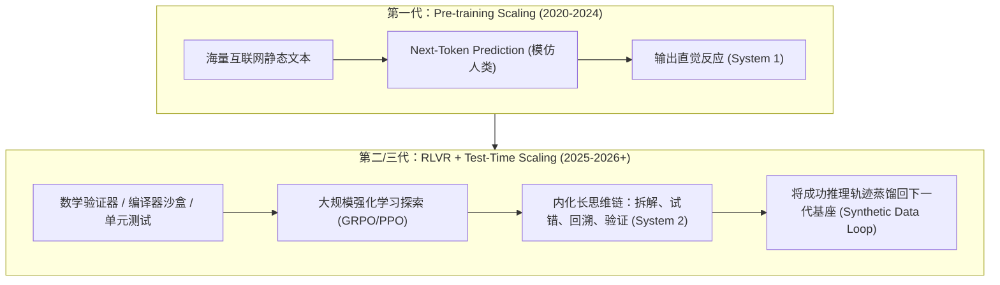

# 📐 专题一：从“大力出奇迹”到“慢思考与软硬协同”——三代 Scaling Law 与底层架构演进原理

> **文档定位**：本文件为 [00_AI_Development_Interview_Main.md](./00_AI_Development_Interview_Main.md) 第一幕的深度技术参考手册。面向具有计算机科学（CS）与人工智能基础的读者，从数学直觉、系统体系结构（Computer Architecture）和训练范式三个角度，剖析 2026 年前后推动 AI 能力与效率跃升的底层原理。

---

## 一、 为什么“无脑堆叠预训练参数量”撞墙了？

在 2020（Kaplan Scaling Law）到 2022（Chinchilla Scaling Law）年间，业界信奉的核心公式是：模型的交叉熵损失 $L(N, D)$ 与模型参数量 $N$、训练 Token 数 $D$ 呈幂律（Power-law）下降关系：

$$L(N, D) = E + \frac{A}{N^\alpha} + \frac{B}{D^\beta}$$

然而，到了 2025–2026 年，单纯放大稠密参数 $N$ 遇到了三重物理与信息论极限：

### 1. 信息论极限：高质量人类语料的枯竭与熵坍缩
- **Chinchilla 最优比例**：每 1 个参数大约需要 20 个高质量训练 Token（后来为降低推理成本，Llama 3 / Qwen 等走向 Over-training，即用 15T+ Token 训练较小模型）。
- 当目标参数量推向数万亿（Trillions）时，需要数十万亿至上百万亿的高质量独立 Token。然而整个互联网经过去重（Deduplication）、低质过滤后的高质量人类自然语言文本总量仅在 $10^{13} \sim 10^{14}$ Token 量级。
- 如果强行用未过滤的网页垃圾或未经检验的普通生成文本去扩充，会导致**模型坍缩（Model Collapse）**或严重的信噪比恶化。

### 2. 计算机体系结构极限：Memory Wall（显存带宽墙）与算术强度
作为 CS 学生，你一定熟悉 **Roofline Model（屋顶线模型）**：
- **预训练（Pre-training）与提示词预填充（Prefill）阶段**：大量 Token 并行矩阵乘法（GEMM），属于 **Compute-bound（算力受限）**，GPU 的 Tensor Core 利用率（MFU）很高。
- **自回归解码（Autoregressive Decoding）阶段**：每次只能串行生成 1 个 Token（矩阵-向量乘法，GEMV）。为了生成这 1 个 Token，必须把整个模型被激活的权重矩阵和历史所有 Token 的 KV Cache 从片外高带宽显存（HBM）搬运到片上缓存（SRAM）。
- **结论**：对于稠密大模型（Dense LLM），参数量增大 10 倍，意味着每生成一个字的显存带宽消耗、延迟和能耗直接劣化 10 倍。在商业部署中，**推理总成本（Inference TCO）早已远超预训练成本**。

---

## 二、 核心突破一：训练与推理范式重构（Post-Training RL & Test-Time Scaling）

既然在预训练阶段“静态压缩全人类文本”接近天花板，研究重心全面转向了 **第二代与第三代 Scaling Law**：**后训练强化学习扩展（Post-Training RL Scaling）** 与 **推理期算力扩展（Test-Time / Inference-Time Compute Scaling）**。

### 1. 从 RLHF 到 RLVR（Reinforcement Learning with Verifiable Rewards）
早期的后训练依赖 **RLHF（基于人类反馈的强化学习）**：让人类标注员给两个回答打分，训练一个奖励模型（Reward Model, RM）。但这存在致命缺陷：
- **Reward Hacking（奖励作弊）**：模型很快学会写出“排版漂亮、语气谦逊、长篇大论但核心逻辑错误”的回答来骗过奖励模型。
- **人类能力上限瓶颈**：对于复杂的竞赛数学、前沿物理或几十万行代码的架构重构，普通人类标注员根本无法判断对错。

**2025–2026 的主流解法是 RLVR（可验证奖励强化学习）**：
- **去奖励模型化（如 DeepSeek-R1 广泛应用的 GRPO - Group Relative Policy Optimization）**：不再训练容易被骗的神经网络 Reward Model，也不用耗费一倍显存去维护 Value Network（Critic），而是对同一个问题采样一组输出 $\{o_1, o_2, \dots, o_G\}$，直接将其扔进**确定性的验证环境**（Python 解释器、C++ 编译器、单元测试套件、Lean 4 形式化数学定理证明器）。
- **组内相对优势计算**：只要测试通过就给确定性正奖励 $r_i$，然后通过组内归一化计算优势函数：
  $$A_i = \frac{r_i - \text{mean}(\{r_1, \dots, r_G\})}{\text{std}(\{r_1, \dots, r_G\})}$$
- **涌现现象（Aha Moment）**：在纯粹的结果奖励驱动下，模型为了拿到高分，自发涌现出了人类没有显式编程教它的元认知能力——例如在思维链中突然写出 `"Wait, let me re-evaluate step 3, there might be an edge case..."`（自我反思、分治验证、回溯重算）。

### 2. Test-Time Compute（推理期算力扩展）的本质
为什么给模型更多“思考 Token”能大幅提升准确率？
- 从计算复杂性理论来看，一个固定层数 $L$ 的 Transformer，其一次前向传播（Forward Pass）能执行的串行逻辑深度是有界的（属于 $\mathsf{TC}^0$ 复杂度类，无法直接解决需要深度串行递推的复杂状态空间搜索问题）。
- 当引入 **Chain-of-Thought（长思维链）** 和 **Test-Time Search（如树搜索、并行采样 + 过程验证器 PRM）** 时，模型实际上把自己的输出 Context 当作了**图灵机的外部读写磁带（External Scratchpad）**，从而突破了固定层数的计算深度限制，用运行时的时间复杂度（Token 数量）换取了指数级提升的逻辑推理上限。

---

## 三、 核心突破二：模型架构演进（极致稀疏化与突破二次方注意力）

为了支撑动辄数万 Token 的长思维链推理（Reasoning Tokens）和百万级上下文的代码库分析，2026 年的模型架构围绕**“降低激活参数比”**与**“消灭 KV Cache 显存瓶颈”**展开了激烈革新：

| 架构创新维度 | 传统 Transformer 痛点 | 2026 主流演进方案与原理 | 代表模型/工作 |
| :--- | :--- | :--- | :--- |
| **FFN 层稀疏化** | 稠密模型（Dense）每次推理需激活 100% 参数，计算与访存开销巨大。 | **细粒度混合专家 + 共享专家（Fine-grained MoE with Shared Experts）**：将 FFN 拆分为数百个小专家，固定激活少量通用“共享专家” + 动态路由激活 Top-K 专精专家；采用**无辅助损失负载均衡（Auxiliary-Loss-Free Load Balancing）**避免损害模型主任务精度。 | DeepSeek-V3/R1, Qwen2.5/3-MoE, Gemini 2/3, GPT-4o/5 |
| **注意力显存压缩** | 标准 MHA/GQA 在长上下文与长推理链下，KV Cache 显存占用随序列长度 $N$ 线性暴涨，限制并发 Batch Size。 | **MLA（Multi-head Latent Attention，多头潜在注意力）**：利用低秩联合压缩（Low-Rank Joint Compression），将 Key 和 Value 投影到一个极低维的潜在向量（Latent Vector）中缓存，推理时再通过矩阵吸收还原，将 KV Cache 显存消耗砍掉 **80%～93%**，同时保持甚至超越标准 MHA 的表达能力。 | DeepSeek 系列及相关开源跟进架构 |
| **超长序列复杂度** | 标准 Softmax Attention 计算复杂度为 $O(N^2)$，处理百万 Token 时延迟过高。 | **混合架构（Hybrid Architectures）与线性注意力**：将标准全局注意力层与 $O(N)$ 复杂度的线性注意力（Linear Attention / Lightning Attention）、状态空间模型（Mamba-2 / SSM）或滑动窗口注意力（SWA）按比例交错堆叠（如 1:7 比例），兼顾精确大海捞针能力与线性吞吐效率。 | QwenLong / MiniMax / Jamba / Google Titans |
| **原生多模态与解码加速** | 单纯逐个预测文本 Token 效率低；外挂视觉编码器存在信息折损。 | **MTP（Multi-Token Prediction，多 Token 预测）+ 投机采样（Speculative Decoding）**：训练时同时预测未来多个位置的 Token，不仅强化了模型的长程规划表征，还能在推理时直接作为轻量草稿头（Draft Head），实现 2～3 倍的无损解码加速。 | DeepSeek-V3, Meta MTP, 各大闭源推理引擎 |

---

## 四、 核心突破三：数据工程的闭环（Synthetic Data & Agent Environments）

在 2026 年，顶尖 AI 实验室里最核心的资产不再是“爬虫脚本”，而是 **“合成数据生成管线 + 可交互沙盒环境集群”**：

1. **System 2 $\rightarrow$ System 1 的知识蒸馏飞轮**：
   - 利用上一代模型开启高成本的 Test-Time Compute（例如消耗 64,000 个思考 Token + 编译器验证），解出一道极难的软件工程 Bug。
   - 对这条推理轨迹进行清洗、剪枝，转化为高质量的训练样本，用于训练下一代基座模型或更小尺寸的模型（如把 600B 模型的推理能力蒸馏到 7B/14B/32B 模型中）。
   - 这实现了 **“用上一代模型的推理算力，去合成下一代模型的训练数据”** 的正反馈飞轮。
2. **SWE（软件工程）与 OS 级虚拟化沙盒农场**：
   - 各大厂商搭建了由数万个并发 Docker 容器和虚拟机组成的强化学习集群。
   - 每个容器里运行着真实的 GitHub 历史仓库、数据库、浏览器和 Linux 终端。模型作为 Agent 在里面自由执行 `bash` 命令、看报错、改代码、跑 `pytest`。这种真实的动态交互数据，是静态网页文本永远无法提供的。
