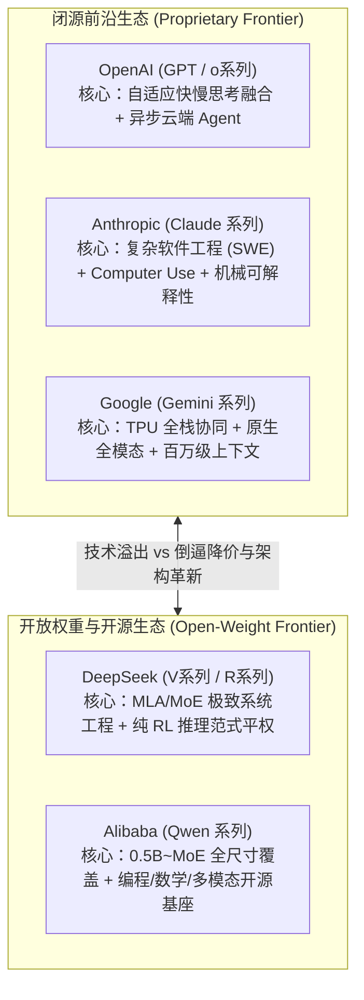

# ⚔️ 专题二：2026 全球五大核心模型流派——技术路线与“内卷”焦点全解

> **文档定位**：本文件为 [00_AI_Development_Interview_Main.md](./00_AI_Development_Interview_Main.md) 第二幕的深度参考手册。详细拆解 **OpenAI (GPT)**、**Anthropic (Claude)**、**Google DeepMind (Gemini)**、**DeepSeek (深度求索)** 与 **Alibaba (Qwen 通义千问)** 在 2025–2026 年的迭代重心、工程壁垒与差异化竞争策略。

---

## 一、 全球五大模型家族全景对比矩阵

在 2026 年，大模型行业已经形成了非常清晰的生态位分化——**闭源三巨头（GPT、Claude、Gemini）在拼“全栈 Agent 生产力、超长上下文生态整合与软硬协同”**，而**开源/开放权重双雄（DeepSeek、Qwen）则在拼“算法-系统极致效率与全尺寸生态垄断”**：

---

## 二、 逐一拆解：五大厂商的更新迭代到底在干什么？

### 1. OpenAI（GPT 系列 & o 系列融合）：从“对话接口”走向“自主智能体操作系统”
OpenAI 是预训练 Scaling Law 与推理期 Scaling Law（o1/o3）的早期定义者。到了 2025–2026 年，OpenAI 的研发重心主要集中在以下三件事：
- **快慢思考的统一路由（Unified Adaptive Reasoning）**：
  早期用户需要手动在“普通对话模型（如 GPT-4o）”和“深度推理模型（如 o1/o3）”之间切换。OpenAI 的核心迭代工作是将两者在底层彻底融合——模型根据问题复杂度**动态分配推理期算力（Dynamic Test-Time Compute Allocation）**：简单问题零延迟直出，遇到复杂系统设计或数学推导自动拉起隐式思维链与工具调用。
- **异步长周期智能体（Asynchronous Long-Horizon Agents）**：
  以 Deep Research、Codex 云端工程 Agent 为代表，OpenAI 重点攻克的是**“让 AI 在后台独立工作 30 分钟到数小时”**。这涉及多步规划（Planning）、环境状态检查点恢复（Checkpointing）、跨网页/终端的真实工具操作以及长程目标对齐。
- **端到端语音与多模态实时交互状态机**：
  在音频流与视觉流上实现毫秒级打断、情绪感知与实时函数调用（Function Calling），试图把 GPT 变成个人与企业的顶层 OS 入口。

---

### 2. Anthropic（Claude 系列）：软件工程（Coding）的绝对统治力与安全控制
由前 OpenAI 核心安全与工程团队创立的 Anthropic，不追求面面俱到的消费级娱乐功能，而是把算力极度聚焦在 **生产力最密集、付费意愿最高的软件工程与企业办公** 领域：
- **死磕真实软件工程生命周期（SWE-bench & Terminal Mastery）**：
  Claude（如 Claude 3.5/3.7 Sonnet 及后续 Claude 4/Opus 迭代，配合 `Claude Code` 终端智能体）之所以下载量和开发者口碑断层领先，是因为 Anthropic 构建了业界最严苛的**全栈代码强化学习环境**。它训练模型不是只写一段孤立的 LeetCode 算法，而是学会使用 `grep`/`git` 浏览数万行代码库、定位跨文件依赖、修改代码、自己跑测试、看报错日志并迭代修复。
- **Computer Use（通用 GUI 桌面操作）**：
  不是所有软件都有 API。Anthropic 率先发力让模型像人一样直接“看屏幕截图、移动鼠标光标、点击按钮、敲击键盘”，打通了操作老旧企业软件（Legacy Enterprise Software）的最后一公里。
- **机械可解释性（Mechanistic Interpretability）与精准对齐**：
  Anthropic 在打开神经网络黑盒上走得最远（利用稀疏自编码器 Sparse Autoencoders 定位模型内部数百万个特定语义特征神经元）。这使得 Claude 在长文写作、复杂提示词遵循（Instruction Following）和避免“AI 腔调”上表现得极其细腻可控。

---

### 3. Google DeepMind（Gemini 系列）：原生全模态、超长上下文与 TPU 算力霸权
背靠 Google 的搜索基础设施与 DeepMind 的诺贝尔奖级科研底蕴（AlphaFold / AlphaGeometry / AlphaProof），Gemini 走的是其他创业公司无法复制的**“软硬一体 + 原生全模态”**路线：
- **真正的原生多模态（Native Multimodality from Scratch）**：
  许多厂商的多模态是“先训练一个纯文本 LLM，再外挂一个视觉编码器（如 ViT）做投影对齐”。而 Gemini 从预训练的第一个 Token 起，就把文本、代码、图像、原生音频流、长视频帧放在同一个混合字典里联合训练。因此它可以无缝理解一段 2 小时的视频中包含的细微声音变化、画面文字与代码逻辑。
- **百万至千万级上下文窗口（1M–10M+ Context）与工程级缓存**：
  依托改进的 Ring Attention 与软硬件协同的 Context Caching 技术，Gemini 让用户可以直接把整本几千页的技术手册、整个大型项目的全部源码、或者几十篇学术论文一次性塞进上下文，极大地简化了传统碎片化 RAG（检索增强生成）带来的信息丢失问题。
- **TPU 全栈自研优势与 Deep Think（多假说树搜索推理）**：
  当其他厂商受制于英伟达（NVIDIA）GPU 的高昂溢价与供应链紧缺时，Google 依靠自研的 TPU（Tensor Processing Unit）集群实现了从芯片微架构、光互连网络（OCS）到 JAX/XLA 编译器的垂直整合。同时结合 DeepMind 传统的蒙特卡洛树搜索（MCTS）基因，在奥数证明、算法竞赛和科学发现上持续突破上限。

---

### 4. DeepSeek（深度求索）：算法-系统协同（Co-design）的极限艺术与开源破局者
DeepSeek 是 2024–2026 年全球 AI 界最大的震撼弹。在面临高端算力卡受限的客观环境下，DeepSeek 证明了**“极致的系统工程与底层架构创新，可以弥补数倍的硬件算力代差”**：
- **重写底层基础设施与通信极限**：
  DeepSeek 团队没有停留在调参层面，而是深入到底层硬件微架构（如直接编写 PTX 汇编指令管理流多处理器 SM 的通信配比、研发 DualPipe 双向流水线并行以完全掩盖跨节点通信延迟、原生实现细粒度 FP8 混合精度训练）。
- **MLA 与 DeepSeekMoE 架构创新**：
  通过多头潜在注意力（MLA）将推理最昂贵的 KV Cache 压缩了 90% 以上；通过细粒度专家分割与无辅助损失的动态偏置路由，解决了大规模 MoE 训练容易出现的路由崩溃（Routing Collapse）与负载不均问题。
- **R1 纯强化学习推理范式的开源共享**：
  DeepSeek 将“如何不依赖海量人类监督数据，仅靠大规模强化学习（GRPO）激发出模型深度推理与自我反思能力”的完整配方（Recipe）与权重公之于众，不仅大幅拉低了全球推理 API 的价格，更直接抹平了开源社区与硅谷顶尖闭源实验室之间的算法黑盒代差。

---

### 5. Qwen（阿里通义千问）：全球开源生态的“Linux 级”基础设施
如果说 DeepSeek 是锐利的尖刀，那么阿里的 Qwen（通义千问）家族就是支撑整个全球开源大模型生态的**全能型航空母舰**：
- **全尺寸（Full-Spectrum）与端云协同布局**：
  Qwen 坚持维护从 **0.5B、1.5B、3B、7B、14B、32B、72B 到巨型 MoE** 的完整尺寸梯队。这意味着无论是手机、树莓派、车载芯片等端侧设备（Edge AI），还是单卡消费级显卡（RTX 4090/5090），亦或是企业级 GPU 集群，开发者都能在 Qwen 家族中找到对应尺寸的 SOTA（同级别最强）模型。
- **垂直领域专精底座（Qwen-Coder / Qwen-Math / Qwen-VL / Qwen-Omni）**：
  Qwen 在高达近 20 万亿（20T+）Token 的多语言高质量语料与合成数据上进行了深度打磨，并专门针对代码生成、数学定理推导、高分辨率动态视觉理解（Naive Dynamic Resolution）和端到端全模态语音交互推出专精版本。
- **事实上的开源标准底座**：
  在 Hugging Face 等全球开源社区中，基于 Qwen 进行二次微调（Fine-tuning）、领域对齐和蒸馏的衍生模型数量常年位居榜首，成为全球学术界研究和中小企业私有化部署（On-Premise Deployment）的首选基座。
