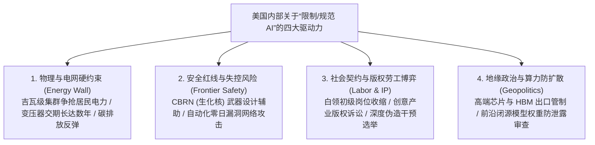

# 🫧 专题三：AI 泡沫悖论、能源与监管博弈及未来十年（2026–2036）终局推演

> **文档定位**：本文件为 [00_AI_Development_Interview_Main.md](./00_AI_Development_Interview_Main.md) 第三幕与第四幕的深度参考手册。从宏观经济学、电力能源工程、全球政策博弈及计算机科学长远演进四个维度，解答“为什么 AI 能力空前强大，市场却在争论泡沫与限制？”以及“未来十几年什么技术真正决定胜负？”。

---

## 一、 解剖“AI 泡沫悖论”：为什么技术能力空前高涨，华尔街却在喊泡沫？

很多工科学生会感到困惑：**“我每天都在用 Claude、GPT、Gemini 和 DeepSeek 写代码、读论文，效率明明提升了好几倍，能力空前强大，为什么美国金融界和媒体却整天讨论 AI 泡沫（AI Bubble）甚至担心崩盘？”**

答案在于：**技术革命的真实性，并不自动免疫金融周期的错配。** 19 世纪的英国铁路狂潮和 2000 年的互联网泡沫（Dot-com Bubble）最终都彻底改变了人类文明，但在基建狂飙阶段都经历了剧烈的财务清算。

### 1. 万亿美元的“折旧钟摆”（The Trillion-Dollar Depreciation Clock）
让我们用工程经济学的视角算一笔账：
- **资本开支（CapEx）规模**：2024–2026 年，仅北美四大云厂商（Microsoft, Google, Meta, Amazon）加上各类算力租赁巨头（CoreWeave 等）及主权基金，投入到 AI 数据中心的资金规模以**每年数千亿美元**计，累计逼近万亿美元大关。
- **硬件寿命的残酷性**：2000 年互联网泡沫时期铺设的地下暗光纤（Dark Fiber），哪怕公司破产了，光纤埋在地下 15 年后依然能用；但今天购买的价值数万美元的 B200/Rubin 等 AI 加速卡，**其高价值经济折旧周期只有 3 到 4 年**。
- **收入剪刀差**：如果每年硬件折旧 + 电力运维成本高达 3000 亿～5000 亿美元，那么全球企业与消费者每年必须为 AI 软件服务额外支付 **6000 亿～1 万亿美元以上** 的高毛利订阅费或 API 费用，才能让这笔基建投资实现健康的投资回报率（ROI）。而在 2026 年，虽然 AI 收入增长极快（达数百亿至上千亿美元量级），但距离填平万亿级 CapEx 鸿沟仍有巨大时间差。

### 2. “循环融资（Circular Financing）”与影子银行杠杆
到了 2025–2026 年，引发美国监管机构（如美联储、IMF、司法部）警惕的另一个金融现象是：
- 算力巨头或云巨头向 AI 独角兽注资数十亿美元 $\rightarrow$ AI 独角兽拿到钱后，转头全部用来购买该巨头的芯片或租用其云算力 $\rightarrow$ 巨头财报上显示营收暴涨、股价飙升。
- 此外，为了扩建超大型数据中心集群（如吉瓦级园区），大量私募信贷（Private Credit / Shadow Banking）和能源债券被引入。如果下游企业客户的 AI 采购增速哪怕放缓一个季度，这种高杠杆链条就会面临剧烈的估值回调。

### 3. 企业落地的“90% 陷阱”（The Last-Mile Reliability Gap）
为什么现在的 AI 能力空前高，却还没有瞬间接管所有传统行业？
- **个人效率 vs 组织流程**：程序员用 AI 写一个函数，哪怕 AI 有 10% 的概率写错，程序员看一眼就能改过来（容错成本极低，个人生产力暴涨）。
- **生产环境的严苛性**：但如果要让 AI 全自动接管一家银行的信贷审批、一家医院的诊断开药、或一家跨国制造企业的供应链调度，**95% 的准确率是不及格的**。那 5% 的长尾幻觉（Hallucination）、权限越界或提示词注入攻击（Prompt Injection），会导致严重的法律与财务灾难。因此，传统企业从“试用 AI（Pilot）”走向“全面重构核心业务系统（Production）”，需要花费数年时间进行数据治理、安全护栏建设与合规改造。

---

## 二、 为什么美国会出现“限制 AI 发展”的呼声与行动？

“限制 AI”并非铁板一块，而是由**物理瓶颈、内部社会矛盾、国家安全博弈**共同构成的复合体：

1. **物理墙与电力危机（The Power & Grid Bottleneck）**：
   AI 的尽头是能源。训练和运行前沿推理模型（尤其是开启大量 Test-Time Compute 后）让数据中心变成了吞电巨兽。北美电网基础设施相对老化，新建高压输电线路和燃气/核能电站的审批往往需要 5～8 年。当科技巨头直接包下核电站（如三里岛重启、SMR 小型模块化核反应堆协议）时，地方公用事业监管机构为了防止普通家庭电费暴涨和电网瘫痪，不得不严格限制新数据中心的并网审批。
2. **前沿安全阈值监管（Compute & Capability Thresholds）**：
   当训练算力超过 $10^{26} \sim 10^{27}$ FLOPs，且模型在软件漏洞利用（Autonomous Cyber Offense）和分子生物学设计上展现出超越人类专家的能力时，各国安全部门必然要求在模型发布前进行强制红队测试（Red-Teaming）与许可证备案。

---

## 三、 未来 5～15 年（2026–2040）：决胜未来的六大核心技术高地

站在 2026 年展望未来十几年，当文本大模型（LLM）逐渐像关系型数据库或操作系统一样成为成熟的基础设施后，真正决定下一代科技霸权与产业革命的核心技术将转向以下六个维度：

### 1. 可验证的自主智能体工程（Verifiable Agentic Engineering）
- **痛点**：基于概率采样的神经网络天生具有不确定性（Stochasticity），多步串联必然导致误差指数级放大。
- **未来关键技术**：**神经符号结合（Neuro-Symbolic AI）**。用神经网络负责发散性的直觉搜索（提出猜想、生成代码草稿），用确定性的形式化工具（编译器类型系统、形式化验证语言如 Lean/Coq、定理证明器、沙盒状态机）负责严格把关。谁能把这一套“生成—验证—回滚”做成工业级标准中间件，谁就能统治企业级软件市场。

### 2. 动态参数更新与终身持续学习（Continual Learning & Test-Time Training）
- **痛点**：人类实习生入职一个月就能熟悉公司的私有代码库和业务潜规则，并 permanently（永久）长在脑子里；而现在的 LLM 无论和它聊多少次，它的底层权重都是冻结的（Frozen），一旦清空 Context 就忘得一干二净。
- **未来关键技术**：研发新型的**神经记忆架构（如基于快速权重 Fast Weights、测试时训练 Test-Time Training [TTT] 或分层记忆网络）**，允许模型在日常推理服务中，以极低的计算开销安全地将新知识巩固（Consolidate）到长期参数记忆中，同时在数学上保证不会发生覆盖旧知识的“灾难性遗忘（Catastrophic Forgetting）”。

### 3. 物理世界模型（World Models）与非语言表征
- **痛点**：以图灵奖得主 Yann LeCun、李飞飞等为代表的学者反复指出，人类语言只是对真实三维物理世界的极度简化投影。你无法仅靠阅读一万本游泳教程学会游泳。
- **未来关键技术**：超越自回归 Token 预测（如在联合嵌入预测架构 JEPA、视频-物理联合潜空间建模、3D 高斯泼溅与神经物理引擎方向突破），让 AI 通过观察海量视频和传感器数据，在内部构建起符合牛顿力学、热力学与空间几何的**世界模拟器**，具备在行动前在脑海中进行物理推演（Mental Simulation）的能力。

### 4. 具身智能（Embodied AI）与 VLA（视觉-语言-动作）统一基座
- **趋势**：未来 10 年最大的增量市场不在手机屏幕里，而在物理世界中——人形机器人、全无人驾驶、自动化柔性产线、高危环境作业机器人。
- **未来关键技术**：解决机器人领域的“莫拉维克悖论（Moravec's Paradox，下国际象棋很容易，但像三岁小孩一样灵巧地叠衣服极难）”。关键在于构建能够接收高频多模态传感器输入（视觉、触觉、力矩、本体感知），并直接以 50Hz～1000Hz 频率输出底层电机控制信号的端到端 VLA 大模型，以及通过超逼真物理仿真器（Sim-to-Real）合成百亿小时级别的虚拟机器人训练数据。

### 5. AI for Science（从“理解人类知识”到“发现未知自然规律”）
- **趋势**：这是 AI 含金量最高、最没有泡沫的终极战场。
- **未来关键技术**：将几何深度学习（Geometric Deep Learning）、图神经网络与物理偏微分方程先验融入大模型底座。在**可控核聚变等离子体磁约束实时控制（托卡马克装置）**、**固态电池与超导新材料晶体生成**、**全原子级生命科学模拟（从蛋白质结构预测迈向整个虚拟细胞的动态代谢模拟）**上，实现人类千年科研范式的跃迁。

### 6. 后冯·诺依曼算力架构与超低功耗推理芯片
- **痛点**：只要还在使用传统的“存储与计算分离”架构，HBM 显存带宽墙和功耗墙就会一直卡住 AI 的脖子。
- **未来关键技术**：**存算一体（Compute-in-Memory / Processing-in-Memory）**、**晶圆级芯片（Wafer-Scale Engine）**、**硅光互连（Optical Interconnects，用光子代替电子进行芯片间高带宽低功耗通信）**，以及专门针对极低比特量化（如 1.58-bit Ternary 模型）和稀疏 MoE 路由定制的专用推理 ASIC。

---

## 四、 总结：给 CS 学习者的行动坐标

| 时间尺度 | 核心产业特征 | 计算机专业学生的核心竞争力锚点 |
| :--- | :--- | :--- |
| **近期 (2026–2028)** | Agent 落地攻坚期、推理成本价格战、企业级可靠性改造 | 掌握 Agent 架构设计、工具沙盒构建、RAG 与长上下文混合工程、CUDA/Triton 算子与推理引擎优化（vLLM / SGLang）。 |
| **中期 (2028–2032)** | 世界模型成熟、持续学习突破、AI 接管大部分常规软件工程与科研辅助 | 深入理解强化学习（RL）环境建模、形式化验证（Formal Verification）、软硬协同编译（MLSys）、跨模态表征学习。 |
| **远期 (2032–2040)** | 具身智能普及、AI4Science 爆发、硅基生产力全面融入物理经济 | 具备跨学科系统视野（CS + 物理/生物/机器人控制/芯片体系结构），成为定义问题、设计评价函数（Reward Function）与掌控复杂系统边界的架构师。 |
