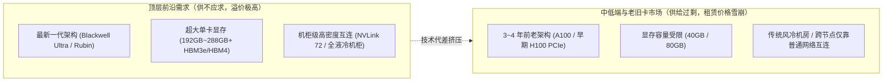

# 🔍 深度访谈追问录：计算机体系结构、算力经济学与技术细节深潜

> **文档定位**：本文件为 [00_AI_Development_Interview_Main.md](./00_AI_Development_Interview_Main.md) 的续篇与深度追问记录（Follow-up Q&A）。专门用于记录并拆解针对前序访谈中衍生出的底层硬件机制、算力经济学、具体算法细节与工程瓶颈的连续追问。

---

## 📌 追问一：AI 加速卡的“3～4 年高价值寿命之谜”与复用限制

### 🧑‍🎓 提问者（CS 学生）：
> AI 加速卡，其高价值经济折旧周期只有 3 到 4 年。为什么？显卡的需求情况和复用的限制是什么？

### 🤖 回答者（Antigravity）：
作为计算机专业的学生，你可能会有一个很自然的直觉：**“一块 CPU 或普通家用显卡（如 RTX 3080）用上 6～8 年依然能开机跑程序，硅晶片只要没烧坏就能一直做矩阵乘法，为什么数据中心里价值 3 万～4 万美元的顶级 AI 加速卡（如 A100 / H100 / B200），高价值经济寿命却只有短短的 3 到 4 年？”**

这里的核心区别在于 **“物理寿命（Physical Lifespan）”** 与 **“经济寿命（Economic Useful Life）”** 的背离。在超大规模数据中心里，决定一张卡死活的不是“它还能不能转”，而是 **“它每消耗 1 度电所产出的 Token 价值，还够不够交它的电费和机架租金”**，以及 **“它的底层微架构还能不能支持最新一代模型的数值格式与通信拓扑”**。

我们可以从 **能效比淘汰、底层微架构代差、物理老化、供需结构断层以及复用硬限制** 五个维度来彻底拆解：

---

### 一、 为什么高价值经济折旧期只有 3～4 年？（三大核心成因）

#### 1. “运营成本（OpEx）倒挂”：电费与机架配额比显卡残值更贵
在 2026 年的数据中心里，**最稀缺的资源已经不是显卡本身，而是“带电的机架空间（Powered Rack Space）”**。
- **能效比（Tokens per Watt）的残酷代差**：在英伟达“一年一迭代（One-Year Rhythm：Hopper $\rightarrow$ Blackwell $\rightarrow$ Rubin）”的狂飙下，每一代新架构在结合了更低比特精度和更大显存带宽后，单位功耗下的推理吞吐量（Tokens/s/Watt）往往提升 **3 倍～5 倍甚至更高**。
- **算一笔经济账**：假设你的数据中心只批下来了 50 兆瓦（MW）的电力配额。
  - 如果你继续插着 4 年前的老卡（如 A100），哪怕这些老卡在财务账面上已经折旧完毕（硬件成本视为 0），但它占用了极其宝贵的机位和电力，每发 1 度电产出的 Token 只有新卡的 1/5 到 1/10。
  - 当市场上推理 API 的价格随着新卡普及而暴跌 80% 时，**用老卡跑推理赚到的钱，甚至连它自己吃掉的电费、液冷散热费和数据中心机位费都付不起**。这就叫“经济性死亡”——还没坏，但开机即亏钱，必须拔下来给新卡腾位置。

#### 2. 微架构与数值精度淘汰（Hardware-Software Co-design Obsolescence）
大模型算法与底层硬件指令集是深度绑定的，老卡在硬件电路上直接缺少新模型必需的硬件加速单元（Tensor Core 指令集）：
- **A100（2020 年，Ampere 架构）**：只支持到 **BF16 / FP16** 和 INT8，**硬件不支持原生 FP8**。而 2025–2026 年的主流前沿模型（如 DeepSeek-V3/R1、Llama 4 等）全部深度依赖原生 **FP8 混合精度训练与推理**。拿 A100 去跑 FP8 模型，必须反量化回 BF16 计算，算力瞬间腰斩。
- **H100/H200（2022–2023 年，Hopper 架构）**：支持了 FP8，但到了 **Blackwell（B200）与 Rubin（R100/R200）** 时代，行业推理主力已经全面转向硬件级 **FP4 / NVFP4（4-bit 浮点）** 以及硬件级微缩放格式（Microscaling Formats, MXFP4/MXFP6）。
- **结论**：仅仅隔了 3～4 年，老卡不仅绝对算力慢，而且因为**不支持新一代低比特浮点硬件指令**，在跑新模型时会遭遇成倍的架构级性能惩罚。

#### 3. 7×24 小时满负荷下的物理衰减（Thermal Cycling & Silicon Degradation）
和家用游戏显卡每天只玩两三个小时不同，AI 集群里的 GPU 常年处于 **700W～1200W+ TDP（热设计功耗）** 的极限满载状态：
- **热应力疲劳（Thermal Cycling）**：在训练任务切换、Checkpoint 保存或梯度同步的间隙，GPU 功耗会在一秒钟内从 100W 暴涨到 1000W 再跌落。高频的冷热交替会导致 BGA 焊球、CoWoS 先进封装中介层（Interposer）产生微裂纹。
- **HBM 显存与光模块高故障率**：在大规模集群中，运行满 3 年以上的板卡，其高带宽显存（HBM ECC 双比特不可纠错报错）和配套的高速光模块（800G/1.6T Optical Transceivers）失效率会显著攀升。一旦单张卡在万卡集群训练中掉线，就会导致整个训练任务中断回滚（浪费数万美元的集群空转时间），因此前沿实验室绝不敢用 3 年以上的老卡跑核心大训练。

---

### 二、 当前显卡的需求情况：从“全面饥渴”走向“严重的两极分化”

到了 2026 年，AI 算力市场的需求不再是 2023 年那种“只要是张卡就能加价卖”的盲目状态，而是呈现出鲜明的**结构性分化**：

1. **最新代际“机柜级液冷集群”依然一卡难求**：
   - 随着万亿参数 MoE 模型和数万 Token 的长思维链推理（Test-Time Compute）普及，五大厂商争抢的是像 **GB200/GB300 NVL72 或 Rubin NVL** 这样将 72 张甚至更多 GPU 通过超高速铜缆/背板连成“一整块巨型超级 GPU”的机柜级系统。
2. **老一代算力（A100 乃至早期风冷 H100）租赁价格大幅跳水**：
   - 大量早期囤积了老卡的二三线算力租赁商发现，大客户在续约时纷纷要求升级到最新一代架构，导致老卡的每小时租赁价格在短短两年内下跌了 60%～75%，只能降价租给高校实验室、中小型微调任务或非实时批处理业务。

---

### 三、 显卡复用的四大硬核限制（为什么老卡很难“凑合用”？）

既然退下来的老卡（比如几万张 A100 或早期 H100）还没坏，为什么不能把它们简单拼凑起来，复用去干最前沿的活，或者无缝流转给普通企业？这里有四个计算机系统层面的硬限制：

#### 限制 1：显存容量与带宽的“一票否决权”（The Memory & KV Cache Wall）
- **装不下就是装不下**：算力慢一点顶多是跑得久一点，但**显存（VRAM）不够是硬门槛**。前沿 MoE 大模型动辄数千亿参数，外加百万级上下文窗口（1M Context）产生的巨量 KV Cache。
- **通信墙（Interconnect Bottleneck）**：如果你试图用 16 张 80GB 的老卡去拼凑出 8 张 192GB 新卡的显存容量，你就必须跨越节点边界进行张量并行（Tensor Parallelism, TP）或专家并行（Expert Parallelism, EP）。而在自回归解码阶段，每生成 1 个 Token 都要做几十次 `AllReduce` 或 `All-to-All` 集合通信。老卡之间较低的互连带宽（如 400G/600GB/s vs 新架构的 1.8TB/s 甚至更高机柜内全互连）会让 GPU 90% 的时间都在**空等网络通信（Communication-bound）**，算力利用率（MFU）惨不忍睹。

#### 限制 2：异构集群混训的“木桶效应”（Straggler Problem in Heterogeneous Clusters）
- 能不能把老卡和新卡混在一起训练同一个大模型？在工程上极其痛苦。
- 分布式同步训练（Synchronous Data/Pipeline Parallelism）遵循严格的**木桶定律**：每一次梯度更新（Step），最快的卡都必须停下来等待最慢的卡算完并同步梯度。且不同代际 GPU 的浮点数舍入行为、算子切分策略（Tile Size）完全不同，混训带来的系统调度损耗往往得不偿失。

#### 限制 3：数据中心物理基础设施不兼容（风冷 vs 液冷，配电不可逆）
- **老卡复用找不到合适的机房，新卡也插不进老卡的机槽**：
  - 早期 A100/H100 时代以 **风冷机架（单机柜功率 10kW～30kW）** 为主；而 2025–2026 年的新一代集群全面转向 **高密度直冷式液冷机柜（Direct-to-Chip Liquid Cooling，单机柜功率高达 120kW～150kW+）**，因为只有把几十张卡极其紧密地塞在同一个机柜里，才能用低成本高速铜缆（Copper）跑通超高速 NVLink。
  - 这意味着：云厂商淘汰老卡时，连同老式的风冷服务器底板、供电模块（PDU）和网络交换机都要整套淘汰，无法直接“拔下旧芯片、插上新芯片”。

#### 限制 4：向中小企业/边缘侧下沉的“形态壁垒”（SXM 模组 vs PCIe 插卡）
- 大厂主力采购的训练/推理卡并不是我们平时组装电脑见到的那种带风扇、插在主板 PCIe 插槽上的显卡，而是 **SXM 定制模组（必须焊死或安装在昂贵的 HGX 专用 8 卡高密度服务器底板上）**，且采用无风扇被动散热（需要机房级强力风道或液冷管路），单台 8 卡服务器功耗高达 6,000W～10,000W，噪音超过 85 分贝。
- 普通中小企业或高校实验室如果没有专门改造过的工业级高功率机房和 380V 工业配电，就算白送给他一台淘汰下来的 HGX SXM 服务器，他在普通办公室里连电都通不上。

---

### 四、 总结：退役下来的 AI 加速卡最终去哪了？（算力梯次利用）

尽管退出了“前沿大模型训练与高并发商业 API 推理”的一线战场，3～4 年车龄的老卡并不会直接进垃圾场，而是进入**“算力梯次降级复用（Tiered Cascading Reuse）”**：

| 生命阶段 | 役龄 | 核心算力场景 | 经济学特征 |
| :--- | :--- | :--- | :--- |
| **第一阶段（黄金期）** | 0 ～ 2 年 | 前沿基座模型预训练、大规模 RLVR 后训练、高溢价低延迟实时 Agent 推理 | 硬件折旧极高，但凭借代际垄断性能和极高能效比赚取超额毛利。 |
| **第二阶段（平价期）** | 2 ～ 4 年 | 垂类中小模型微调（SFT/LoRA）、离线批量推理（Batch Inference）、合成数据生成、Embedding 向量化与传统推荐系统 | 硬件账面成本已大幅摊销，转做对延迟不敏感、对超大显存要求较低的吞吐型任务。 |
| **第三阶段（长尾残值期）** | 4 ～ 6 年 | 迁移至电力极其廉价的偏远地区（如水电/风电弃电区），服务高校科研、长尾开源社区、中小型科学计算（分子动力学/流体仿真）或拆解翻新 | 只有在“电费接近免费”且“硬件零折旧”的条件下，才能勉强维持正向现金流；一旦超过此阶段即拆解回收贵金属与元件。 |
